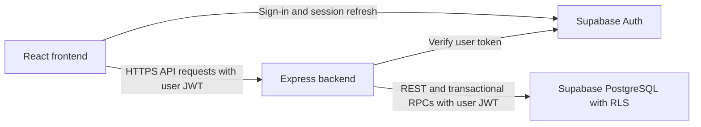

# AlgoDeck

A full-stack adaptive practice workspace for arbitrary question collections: algorithms, system design, language learning and more. React/Vite frontend, Express API, Supabase Auth and PostgreSQL persistence.

[Open the deployed app](https://algodeck-202610111929-web.azurewebsites.net) · [Implementation tracker](todos.md) · [API documentation](https://algodeck-202610111929-web.azurewebsites.net/api/docs)

## What you can do

- Create collections with a daily target, new-question limit and configurable review intervals.
- Add, edit, search, filter, import and export question banks.
- Practice a daily selection, reveal hints/solutions, record notes and time, and rate each attempt Easy, Medium or Hard.
- Resume saved sessions and inspect question history, revision dates, streaks, workload and analytics.
- Sign in with Supabase email/password authentication; each account owns its collections, questions and practice history.

## Architecture



The npm workspace has three packages: React 19/Vite frontend, Express 5 backend and shared TypeScript/Zod contracts. The browser signs in directly with Supabase; the backend verifies its token before accessing data as that user. PostgreSQL row-level security and ownership constraints protect records, while transactional functions handle imports, session creation and ratings.

Development runs Vite and Express separately. The Azure deployment runs one Node process: Express serves the compiled frontend and `/api` on the same HTTPS origin. Supabase hosts authentication and the database separately.

## Start here

Requirements: Node 24 LTS (Node 22.12+ also supported), npm, and a Supabase project. Docker is needed only for the complete local Supabase stack.

```powershell
npm ci
if (!(Test-Path backend/.env)) { Copy-Item backend/.env.example backend/.env }
if (!(Test-Path frontend/.env)) { Copy-Item frontend/.env.example frontend/.env }
```

Set your project URL and **public publishable/anon key** in both files. Use the variable names in each example. Keep the two files out of Git. This app does not require a service-role key or database password at runtime. When local configuration already exists, preserve it.

Apply the canonical migrations:

```powershell
npx supabase login
npx supabase link --project-ref YOUR_PROJECT_REF
npm run db:migrate
```

Configure Supabase Auth as described in [setup](docs/setup.md), then:

```powershell
npm run dev
```

Open [http://localhost:5173](http://localhost:5173). API: [http://localhost:3001/api/health](http://localhost:3001/api/health). Swagger: [http://localhost:3001/api/docs](http://localhost:3001/api/docs).

Register, confirm your email if enabled, create a collection, import `examples/questions.csv` or `examples/language-learning.json`, and start daily practice. Each rating immediately persists an immutable attempt and updates the review schedule.

### Environment variables

| File | Variable | Purpose |
|---|---|---|
| `backend/.env` | `SUPABASE_URL` | Supabase project API URL |
| `backend/.env` | `SUPABASE_PUBLIC_KEY` | Public publishable key or legacy anon key |
| `backend/.env` | `PORT` | API listener; development default `3001` |
| `backend/.env` | `FRONTEND_ORIGIN` | Allowed browser origins, comma-separated; development includes `http://localhost:5173` |
| `backend/.env` | `NODE_ENV` | `development` locally, `production` when deployed |
| `backend/.env` | `LOG_LEVEL` | Structured log verbosity; default `info` |
| `backend/.env` | `TRUST_PROXY` | `0` locally; `1` behind the deployed App Service proxy |
| `frontend/.env` | `VITE_SUPABASE_URL` | Same Supabase project URL |
| `frontend/.env` | `VITE_SUPABASE_PUBLIC_KEY` | Same public key, embedded in the browser build |
| `frontend/.env` | `VITE_API_URL` | Leave empty for Vite proxy and same-origin production; otherwise API origin without `/api` |

Frontend variables are fixed at build time; changing the Supabase project requires rebuilding the frontend. Server variables are read at startup. Runtime uses the Supabase API, so an Azure PostgreSQL connection string is unnecessary. Keep passwords, CLI tokens and service-role keys out of source and frontend variables.

For a fully local database, start Docker Desktop and follow the [local Supabase instructions](docs/setup.md#local-stack). Automated database tests use embedded PostgreSQL and do not require Docker or a hosted project.

## Importing question banks

Open a collection and choose its import action. Paste CSV/JSON or select a file. Imports allow up to **1 MB and 1,000 questions**. Invalid rows prevent the whole import; repeated normalized title/category/pattern identities are skipped.

### CSV

Use these exact, case-sensitive headers. Only `title` is required; omit optional columns or leave their cells empty.

```csv
title,content,category,pattern,source_url
Two Sum,"Find a pair that adds to a target, and explain why it works.",Algorithms,Hash map,
Tree Traversal,Compare breadth-first and depth-first traversal.,Algorithms,Trees,
```

| Column | Meaning |
|---|---|
| `title` | Required question title, up to 200 characters |
| `content` | Question text, up to 20,000 characters |
| `category` | Topic or grouping label, up to 80 characters |
| `pattern` | Technique or pattern label, up to 80 characters |
| `source_url` | Optional HTTP/HTTPS source link |

Quote cells containing commas, quotes or line breaks; double embedded quotes. See [the sample CSV](examples/questions.csv).

**Question complexity:** There is no dedicated `difficulty` or `complexity` import column. Unsupported headers are rejected. Easy/Medium/Hard are self-ratings submitted during practice, which determine future review scheduling. If you need an initial complexity label, put it in `category` or the question text; this label does not affect the scheduler.

### JSON

JSON accepts an array of questions or an object with a `questions` array. It supports the same fields plus a `metadata` object for hints, solutions and other information:

```json
[
  {
    "title": "Two Sum",
    "content": "Find two distinct numbers that add to a target.",
    "category": "Algorithms",
    "pattern": "Hash map",
    "metadata": {
      "hint": "Store previously seen numbers.",
      "solution": "Check whether the complement has already been seen."
    }
  }
]
```

CSV does not parse a JSON `metadata` cell; use JSON to import hints and solutions. See [the sample JSON](examples/language-learning.json). Collection exports produce JSON that can be imported again.

## Commands

| Command | Behavior |
|---|---|
| `npm run dev` | Build shared contracts and run Vite + Express with file watching |
| `npm run build` | Build shared JS/types, API JS, and production frontend |
| `npm run lint` | Strict TypeScript checks across contracts, API, tests and frontend |
| `npm test` | Scheduler/import/PostgreSQL unit tests and React workflow tests |
| `npm run test:integration` | Supertest API tests with disposable PostgreSQL and two authenticated users |
| `npm run db:migrate` | Apply pending migrations to the linked Supabase project |
| `npm run db:migrate -- --local` | Apply pending migrations to a running local Supabase instance |
| `npm run db:seed` | Import the example collection for an authenticated development account |
| `npm run security` | Audit production dependencies |
| `npm audit` | Audit all dependencies, including test tools |
| `npm run format` | Format the application source |
| `npm start` | Start compiled Express; in production it also serves `frontend/dist` when present |
| `npm start -w backend` | Start the compiled API (after root build) |

## Verification

From the repository root:

```powershell
npm run lint
npm test
npm run test:integration
npm run build
npm run security
```

The deployment verification passed 25 backend/database tests, 12 API integration tests and 7 frontend tests (44 total), strict TypeScript checks and the production build. The production dependency audit reported zero vulnerabilities at that time; rerun it for current results.

Tests cover scheduling, import validation, ownership/RLS, concurrent and idempotent transactions, API authentication and React workflows. Hosted checks verified Supabase readiness, sign-in, saved collections and a completed session surviving refresh. See [testing details](docs/testing.md) and [hosted practice proof](docs/screenshots/azure-practice-complete.jpg).

## Repository

`frontend/src/features` contains routed product features; `frontend/src/components` contains reusable accessible primitives. `backend/src/controllers` validates HTTP inputs, `services` owns business behavior, and `repositories` accesses Supabase with the verified caller JWT. `shared/src` provides contracts and schemas. Canonical SQL exists only in `supabase/migrations`; it is exercised directly by database tests.

```text
frontend/           React pages, components, browser API client and tests
backend/            Express routes, middleware, business services and tests
shared/             Shared schemas, types and date helpers
supabase/           Canonical migrations, local configuration and seed SQL
examples/           CSV and JSON question banks
scripts/            Database migration and development seed entry points
deploy/             nginx configuration and Kubernetes manifests
docs/               Setup, scheduling, security, testing and deployment guides
Dockerfile          Backend container build
frontend/Dockerfile Frontend container build
prompt.txt          Original product requirements
todos.md            Implementation and verification tracker
```

## API

All application routes use the `/api` prefix. Private routes require `Authorization: Bearer <Supabase access token>`. The frontend handles this automatically.

| Route group | Purpose |
|---|---|
| `/api/collections` | Collection CRUD and settings |
| `/api/collections/:id/questions`, `/api/questions/:id` | Question CRUD, search and filtering |
| `/api/collections/:id/import`, `/api/collections/:id/export` | Atomic import and JSON export |
| `/api/collections/:id/sessions`, `/api/sessions/:id` | Create/resume and read a daily session |
| `/api/sessions/:id/questions/:questionId/rate` | Save a rating, notes, elapsed time and next review |
| `/api/collections/:id/revision-queue`, `/api/questions/:id/history` | Upcoming reviews and attempt history |
| `/api/dashboard`, `/api/collections/:id/analytics` | Dashboard and collection analytics |
| `/api/health`, `/api/ready` | Public liveness and Supabase/schema readiness |
| `/api/docs`, `/api/openapi.json` | Public Swagger UI and OpenAPI contract |

Use OpenAPI for HTTP methods, request schemas, pagination and response details. Readiness does not verify email delivery or every authenticated workflow.

## Important behavior

- A session is unique per user, collection and timezone-local study date. Repeating creation returns the persisted session. SQL transactions protect concurrent generation.
- Questions selected yesterday are excluded today, even if unanswered. They retain their overdue priority and can return on a later day.
- New questions obey the collection’s new-question limit. A shortage is explicit; the app does not fill spots with ineligible questions. Empty sessions can be completed but remain the session for that study day.
- Easy/Medium ratings count as success. Hard ratings reset the success streak and increase priority. Default intervals are configurable heuristics, not scientifically validated optimal schedules.
- Question deletion archives the question; attempts and existing sessions remain. Collections with sessions must be archived. Only collections without practice history can be physically deleted.
- Imports are all-or-nothing on invalid rows, with row-level feedback. Repeated normalized title/category/pattern identities are skipped. JSON export can be imported again.
- Editing question text changes what existing sessions display; attempts preserve scheduling history, not historical copies of question text.

See [setup](docs/setup.md), [scheduling](docs/scheduling.md), [security and logging](docs/security.md), [testing](docs/testing.md), and [deployment](docs/deployment.md). The running API publishes [OpenAPI](http://localhost:3001/api/openapi.json).

## Troubleshooting

- **Database unavailable / not ready:** confirm the project URL/key, apply migrations, and check Supabase project availability. Auth can succeed before the application schema exists.
- **Confirmation email:** configure SMTP/Supabase email limits and allowed redirect URLs. Sign in after confirming.
- **No eligible questions:** yesterday’s exclusion, new-question limit, and future review dates are intentional. Add questions or adjust settings for the next study day.
- **CORS denied:** set `FRONTEND_ORIGIN` to the exact browser origin, including port. Restart the API.
- **Cannot reach API:** start both workspaces with root `npm run dev`; frontend `/api` requests use the Vite proxy.
- **Tests cannot connect to localhost:** Supertest needs loopback networking. Run outside a network-restricted sandbox.
- **Local Supabase cannot start:** start Docker Desktop first. Embedded database tests do not require Docker.
- **CSV import rejected:** use only supported headers, supply a nonempty title and check quoting. Use JSON for metadata; do not add a `difficulty` column.
- **Azure site temporarily unavailable:** the Free tier has quotas and cold starts. Check App Service status and logs before changing the hosting plan.

## Azure App Service

See [the App Service guide](docs/azure-app-service.md) for the Free-tier HTTPS deployment, required portal settings and updates. The frontend and backend run together; Supabase stays separate.

The verified deployment uses Linux **Free F1**, Node 22 LTS and a self-contained ZIP with compiled code and production dependencies. App settings hold the server Supabase URL/public key; the frontend contains its public build configuration. The root `npm start` command serves both app layers. HTTPS is required and FTP is disabled.

Free hosting has CPU quotas and idle cold starts. It is suitable for this development demo; availability under production load has not been verified. The earlier temporary AKS resources and failed initial App Service were deleted. Brief AKS provisioning may still appear in delayed Azure billing.

## Azure Kubernetes demo

See [the AKS guide](docs/azure-kubernetes.md) for deploying both containers to a temporary cluster, inspecting the app through localhost port forwarding, and deleting demo resources. A continuously running AKS cluster exceeds a $5 monthly budget.

## Security and operating limits

The app validates inputs with Zod, verifies Supabase tokens, enforces database ownership/RLS and preserves immutable attempt history. It uses Helmet, explicit CORS origins, rate limiting and structured logs without question content or authentication tokens. See [security and logging](docs/security.md).

Analytics and candidate selection currently load the caller's records into the API; very large accounts need SQL aggregation and candidate filtering. In-memory rate limits need coordination when adding replicas. Real two-account hosted isolation, email delivery, production load and backup/restore procedures have not been verified. See [deployment limits](docs/deployment.md#operational-limits) before expanding this demo.
